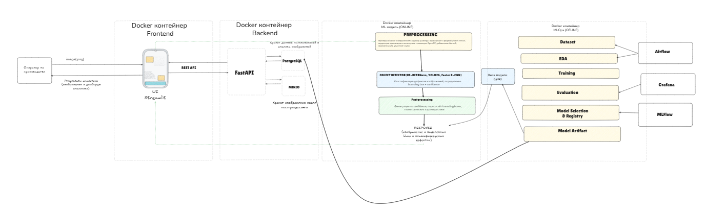
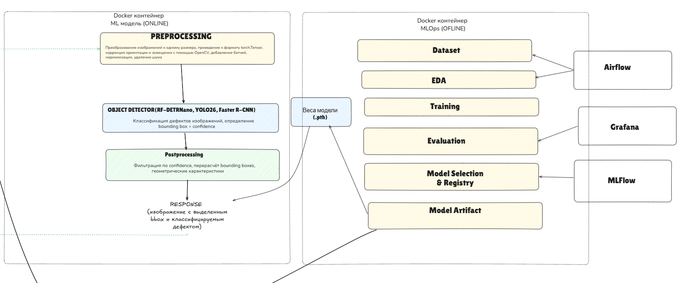
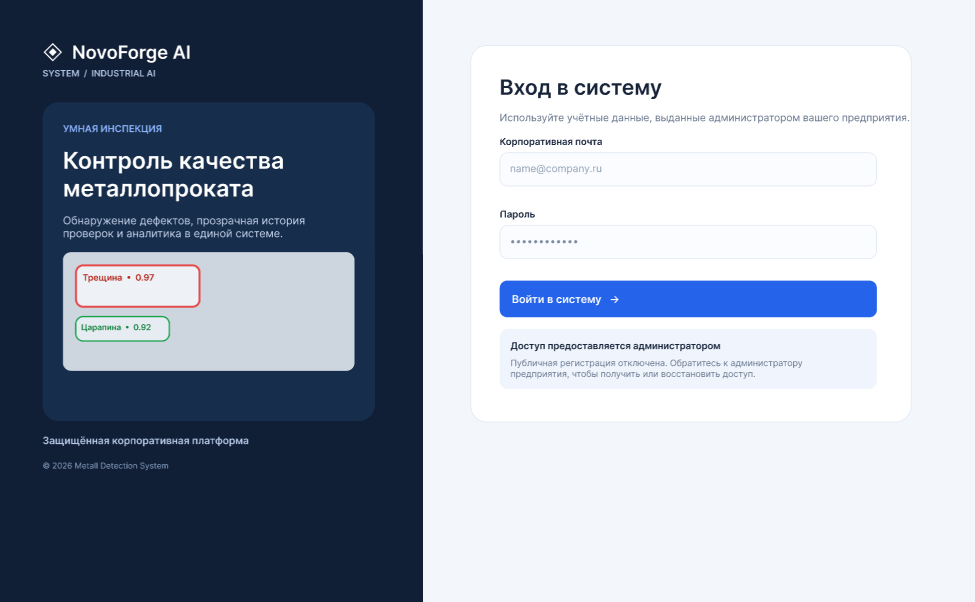

# Система детекции дефектов металлопроката

**Metall Detection System** — разрабатываемая система автоматизированного визуального контроля металлических поверхностей на основе компьютерного зрения. Цель проекта — помогать сотрудникам отдела технического контроля обнаруживать, локализовать и анализировать поверхностные дефекты металлопроката и изделий, сохраняя результаты проверок для последующей аналитики.

## О проекте

Система ориентирована на предприятия металлообработки и металлургии, которым требуется контроль качества поверхностей с возможностью локального развёртывания в собственной инфраструктуре.

**Целевой сценарий:** оператор создаёт рабочую сессию, загружает изображение изделия, запускает модель детекции, просматривает выделенные дефекты и их характеристики, подтверждает результаты и сохраняет инспекцию. Инженер ОТК изучает историю и аналитику по конкретному изделию или группе проверок.

## Архитектура системы


*Рисунок 1 — целевая архитектура MVP.*

Для первой версии рекомендована архитектура **модульного Backend на FastAPI с отдельным сервисом ML inference**:

## ML pipeline



*Рисунок 2 — схема контейнеров системы.*


*Рисунок 2 — архитектура Frontend и Backend контейнеров.*

### Архитектура ML-контейнеров



*Рисунок 3 — архитектура ML-контейнеров.*


## Дизайн веб-интерфейса

### Авторизация



*Рисунок 4 — страница авторизации пользователей с доступом по корпоративной учётной записи.*

### Аналитика дефектов


*Рисунок 5 — страница аналитики, отображающая статистику обнаруженных дефектов, их распределение по классам и динамику изменения показателей.*

### Детекция дефектов


*Рисунок 6 — интерфейс детекции дефектов с визуализацией обнаруженных дефектов, их классов, координат и значений уверенности модели.*

### Инспекции


*Рисунок 7 — страница управления инспекциями, позволяющая создавать проверки, отслеживать текущие сессии и просматривать результаты обработки изображений.*

### История проверок


*Рисунок 8 — страница истории проверок с таблицей инспекций, фильтрацией результатов и возможностью экспорта данных в CSV.*

### Личный кабинет


*Рисунок 9 — личный кабинет пользователя для управления профилем и настройками. Администратору дополнительно доступны функции управления пользователями и их ролями.*


## Структура базы данных

Для хранения информации о пользователях, предприятиях, инспекциях и обнаруженных дефектах.

База данных должна обеспечивать связь между предприятиями, пользователями, инспекциями, изображениями и результатами детекции. Для каждой инспекции предусматривается хранение идентификатора, даты проведения, статуса, информации об операторе и проверяемом изделии. Результаты детекции должны включать класс дефекта, координаты ограничивающей рамки (Bounding Box) и значение уверенности модели (Confidence Score).

Для управления доступом предусматривается ролевая модель. Первоначальный доступ к системе предоставляется администратору предприятия, который самостоятельно создаёт пользователей и назначает им соответствующие роли. Данные различных предприятий должны быть изолированы друг от друга.

Изображения металлопроката и результаты обработки предполагается хранить в объектном хранилище **MinIO**, а в PostgreSQL — метаданные файлов и ссылки на них.


## Анализ данных (EDA)

В репозитории предусмотрен каталог `eda_results/`, предназначенный для хранения результатов разведочного анализа датасета изображений металлопроката. Подготовленные данные размещаются в каталоге `processed_dataset/`.

Анализ данных направлен на исследование распределения дефектов по классам, количества дефектов на изображении, характеристик изображений и качества аннотаций. Особое внимание уделяется случаям присутствия нескольких дефектов разных классов на одном изображении, а также изображениям без дефектов.

Полученные результаты должны использоваться для выявления дисбаланса классов, определения стратегии предобработки и аугментации изображений, проверки качества разметки и формирования обучающей, валидационной и тестовой выборок.

При подготовке данных важно учитывать возможное сходство изображений одного изделия или производственной партии, чтобы предотвратить утечку данных между выборками.

> **Текущий статус:** наличие каталогов `eda_results/` и `processed_dataset/` подтверждено. Точные количественные результаты EDA необходимо дополнить после проверки файлов анализа.

## Machine Learning

ML-компонент системы предназначен для автоматического обнаружения и классификации поверхностных дефектов металлопроката на изображениях.

В качестве основного подхода рассматривается **Object Detection** на базе архитектуры **YOLO**. Такой подход позволяет находить несколько дефектов на одном изображении, определять их классы и локализовать каждый дефект с помощью ограничивающей рамки (Bounding Box).

Проектируемый ML-пайплайн включает следующие этапы:

1. **Data Collection** — сбор и загрузка изображений металлопроката и аннотаций.
2. **Data Validation** — проверка целостности изображений, корректности классов и координат разметки.
3. **Preprocessing** — изменение размеров изображений, нормализация и подготовка аннотаций.
4. **Data Augmentation** — применение аугментаций для повышения устойчивости модели.
5. **Model Training** — обучение модели обнаружения дефектов.
6. **Model Evaluation** — оценка качества модели на валидационной и тестовой выборках.
7. **Inference** — обнаружение дефектов на новых изображениях.
8. **Postprocessing** — фильтрация предсказаний и подготовка результатов для Backend.

Для оценки качества модели предполагается использовать **Precision, Recall, F1-score, mAP@0.5 и mAP@0.5:0.95**. Дополнительно необходимо учитывать скорость инференса, количество ложноположительных срабатываний и долю пропущенных критических дефектов.

Результаты работы модели должны передаваться в Backend и сохраняться для дальнейшего просмотра в веб-интерфейсе. Для каждого дефекта предусматривается отображение класса, координат и уверенности предсказания.

В дальнейшем планируется внедрение инструментов **MLOps**, включая MLflow для отслеживания экспериментов, DVC для версионирования датасетов и мониторинг качества модели на производственных данных.

# Запуск
## Backend

Backend можно запустить с помощью следующей команды:
```python
uvicorn main:app --reload
```
